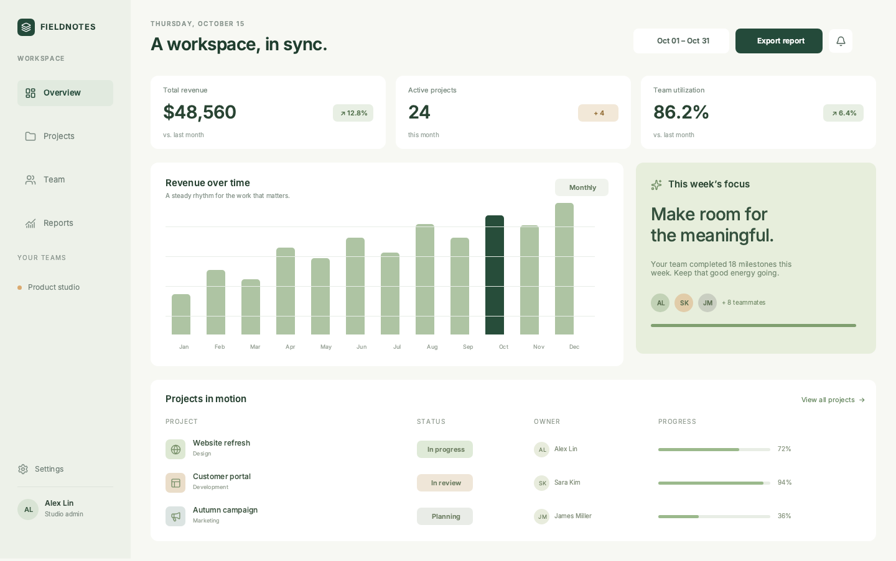
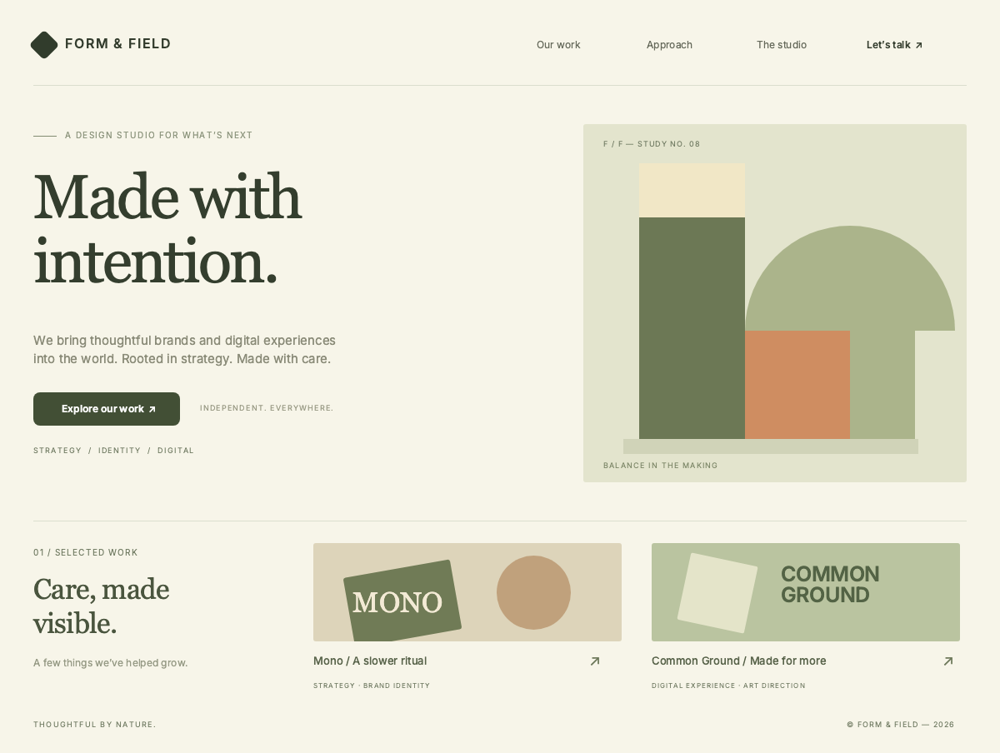
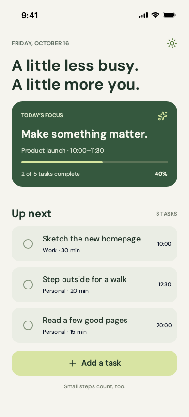

<p align="center">
  
</p>

<h1 align="center">Codex OpenPencil</h1>

<p align="center">
  <strong>The Codex plugin for OpenPencil — create, inspect, and refine editable <code>.op</code> designs from a conversation.</strong><br />
  <sub>One-Prompt Setup &bull; Interactive Canvas &bull; Selection Prompts &bull; Native Rust Engine</sub>
</p>

<p align="center">
  <a href="./README.md"><b>English</b></a> · <a href="./README.zh.md">简体中文</a>
</p>

<p align="center">
  <a href="https://github.com/ZSeven-W/codex-openpencil/releases/latest"></a>
  <a href="https://github.com/ZSeven-W/codex-openpencil/actions/workflows/check.yml"></a>
  <a href="./INSTALL.md"></a>
  <a href="https://github.com/ZSeven-W/codex-openpencil/stargazers"></a>
  <a href="./LICENSE"></a>
  <a href="https://discord.gg/h9Fmyy6pVh"></a>
</p>

<p align="center">
  <a href="#one-prompt-install-and-first-design">Quick Start</a> · <a href="#why-codex-openpencil">Features</a> · <a href="#design-examples">Examples</a> · <a href="./INSTALL.md">Install Guide</a> · <a href="./docs/validation.md">Validation</a>
</p>

<br />

<p align="center">
  
</p>
<p align="center"><sub>FIELDNOTES — a desktop dashboard rendered from an editable <code>.op</code> document, saved and reopened during design testing.</sub></p>

## One-prompt install and first design

Give Codex this:

```text
Install and set up https://github.com/ZSeven-W/codex-openpencil following its INSTALL.md, open an editable canvas, and create a single-page mobile task app.
```

[INSTALL.md](./INSTALL.md) guides Codex through prerequisites, installation, runtime verification, opening the canvas, and completing the first design. Setup downloads the complete Rust editor, matching WASM, CanvasKit, fonts, and templates for your OS and CPU, then verifies a real native edit, save, and reopen before registering the plugin.

You need **Node.js 22+, Git, and a recent local Codex client with plugin support**. No GitHub account, API key, DSH, Rust compiler, separate OpenPencil desktop app, or npm dependency install is needed for this plugin's setup.

Prefer to install manually?

```sh
git clone https://github.com/ZSeven-W/codex-openpencil.git
cd codex-openpencil
npm run setup
```

Keep the checkout in a persistent location. Setup registers it as a local marketplace and installs `openpencil@zseven-openpencil`. A newly installed plugin may need reconnecting or a new chat to load its tools; the [terminal canvas](./INSTALL.md#instructions-for-the-installing-agent) lets Codex complete the first design in the installation chat.

Setup also verifies the tools through Codex's actual plugin loader. It records your current Node executable privately, so a desktop PATH that differs from your terminal does not prevent startup. Use `npm run host-check` to diagnose plugin loading without opening a chat or editing a design.

| Platform | Runtime builds | System requirements |
| --- | --- | --- |
| macOS | Apple Silicon, Intel | Built on macOS 15 native runners |
| Windows | ARM64, x64 | Matching Microsoft Visual C++ v14 Redistributable |
| Linux | ARM64, x64 | glibc, fontconfig, and FreeType; Ubuntu 24.04+ ARM64 / 22.04+ x64 |

See the [full compatibility table and dependency guidance](./INSTALL.md#supported-runtime-builds). Fresh installation and native edit/save/reopen checks passed on all six OS/CPU builds; [validation records](./docs/validation.md) distinguish these checks from bare-OS provisioning and embedded host UI verification.

## Why Codex OpenPencil

Codex OpenPencil connects Codex to the local Rust [OpenPencil](https://github.com/ZSeven-W/openpencil) engine. The result is a real vector document with editable layers, text, shapes, and layout.

<table>
<tr>
<td width="50%" valign="top">

### 🎨 Prompt → Canvas

Describe a dashboard, mobile screen, or landing page. Codex creates and refines native design nodes, inspects layout, and renders previews before saving the result.

</td>
<td width="50%" valign="top">

### ✏️ Interactive Editing

Select layers, pan and zoom, edit text, draw shapes, and undo changes. Mouse edits and Codex tools work on the same document in a managed Rust editor.

</td>
</tr>
<tr>
<td width="50%" valign="top">

### 🎯 Select → Refine

Select one or more elements and describe the change. Captured page and node IDs keep the request attached to those elements and their descendants, even if you select something else later.

</td>
<td width="50%" valign="top">

### 📦 Automatic Runtime Setup

The matching runtime downloads on demand for macOS, Windows, or Linux, on ARM64 or x64. Archive and payload hashes are verified before use; valid custom runtimes stay selected.

</td>
</tr>
<tr>
<td width="50%" valign="top">

### 💾 Editable Files & Recovery

Save portable `.op` files and reopen them later. Each chat owns a separate canvas and recovery draft; source conflict checks and guarded Save As protect existing files.

</td>
<td width="50%" valign="top">

### 🌗 Follows Your Workspace

The panel and editor follow the host's light/dark appearance without reloading the document. Phone designs use the Rust engine's standard status bar.

</td>
</tr>
</table>

## Design with Codex

### 1. Open a canvas

After installation and any required reconnect, ask:

> Open an interactive OpenPencil canvas for this conversation. Create a single-page dashboard for a small design studio.

`open_canvas` starts a separate managed Rust editor. Codex verifies the connection and follows the bundled `openpencil-design` workflow to create, inspect, preview, and save the design. Use another chat for another document; opening an existing `.op` file copies it into the session.

### 2. Select elements and describe a change

Select a card or heading on the canvas, then tell Codex:

> Make the selected card dark green and enlarge its heading. Keep the other elements unchanged.

Select elements in the canvas, then describe your edit in the current Codex chat. Codex reads `canvas_selection` to resolve the active page and node IDs, and confines edits to those subtrees. No copying requests or element IDs is needed.

The canvas footer only shows the selected count and names. Selection context syncs to capable hosts without sending chat messages. Instructions, edit progress and results stay in Codex; there is no second prompt box inside the canvas. Codex verifies the current selection before editing, then inspects the preview and saved design.

### 3. Preview, save, and reopen

> Check the layout, show me a preview, and save this design as an .op file in my project.

The design workflow checks native layout and the rendered PNG, then reads the saved result back. The panel's **Save** button flushes pending browser edits before writing. Changes to the source file outside the editor stop replacement; **Save As** refuses an existing destination. Recovery drafts persist in `~/.codex-openpencil/sessions/`.

## Design examples

These single-page examples were created with native OpenPencil tools and visually inspected. The dashboard and landing page come from the three-case design test; the task app comes from the v0.3.0 first-use test. All were saved and reopened; these images are native renders of editable documents.

<table>
<tr>
<td width="72%" align="center" valign="top">
  
  <br /><strong>FORM &amp; FIELD</strong><br /><sub>Brand landing page · editorial typography and vector artwork</sub>
</td>
<td width="28%" align="center" valign="top">
  
  <br /><strong>A little less busy.</strong><br /><sub>Mobile task app · native status bar and editable task cards</sub>
</td>
</tr>
</table>

## Advanced setup

<details>
<summary><strong>Runtime configuration and updates</strong></summary>

First `open_canvas` use also installs a missing runtime automatically. Private settings stay in `~/.codex-openpencil/runtime.json`; downloaded binaries and machine paths are separate from the plugin package. Failed downloads never activate partial runtimes, and invalid existing configuration is reported explicitly.

To select a complete custom runtime:

```sh
npm run configure-runtime -- /absolute/path/to/runtime
```

To update, inspect the checkout for local changes, pull the published changes, and rerun `npm run setup`. Reconnect the plugin afterward. Valid custom runtimes remain selected, and an interrupted managed upgrade retains the previous configuration. See [repair and update instructions](./INSTALL.md#repair-update-and-manual-runtime).

</details>

<details>
<summary><strong>Connect an existing desktop editor</strong></summary>

Open Rust OpenPencil, enable MCP in Agent Settings, and run:

```sh
npm run doctor
# An intentional isolated endpoint:
npm run doctor -- --port 3100
```

Before a managed canvas opens, the bridge reads `~/.openpencil/.op-mcp-port` and verifies the server identity and matching instance token before forwarding to loopback `/mcp`. It rejects stale records, unrelated listeners, and legacy REST endpoints. Once managed, all native tools route to the owned daemon, including guarded `save_document`. Failed writes are never retried automatically.

Canvas controls remain discoverable with the desktop editor offline. Reconnect after starting the editor to refresh the native catalog. Explicit local ports can use `OPENPENCIL_MCP_PORT` or `--port PORT`. Existing direct MCP configuration may expose duplicate tools; setup preserves unrelated settings.

</details>

<details>
<summary><strong>Host compatibility and current limits</strong></summary>

`open_canvas` advertises an MCP Apps resource and a Codex thread entrypoint. Hosts without MCP Apps UI can open its returned loopback `panelUrl`. The URL is temporary; closing the plugin stops only its owned Rust process, while recovery drafts remain available.

MCP Apps use the initial host theme and live theme notifications. Standalone panels use `prefers-color-scheme`; Codex's in-app browser supplies its resolved app theme.

Native resource loading, browser interaction and embedded Codex UI presentation are separate checks. Live embedded presentation remains unverified. All hosts use the current Codex chat for edit instructions; the plugin never sends a second chat prompt. See [evidence and remaining checks](./docs/validation.md).

This plugin is distributed through the public GitHub repository and releases. It has not been submitted to OpenAI's public Plugin Directory.

</details>

## Development and verification

```sh
npm run check
npm test
# Native/runtime changes also need the relevant isolated smoke checks:
npm run smoke -- --binary /path/to/openpencil-desktop
npm run canvas-smoke
npm run selection-smoke -- --runtime /absolute/path/to/runtime --output /absolute/evidence-dir
npm run mobile-smoke -- --runtime /absolute/path/to/runtime --output /absolute/evidence-dir
# Keep an isolated canvas open for interactive verification:
npm run canvas-smoke -- --hold
```

The smoke runners use isolated file-backed Rust hosts and ignored `artifacts/` outputs. They terminate only their own processes. CI checks packaging and protocol behavior on Linux, macOS, and Windows with Node.js 22/24. A complete compatible runtime is required for native smoke checks.

```text
codex-openpencil/
├── .agents/plugins/          Local marketplace registration
├── plugins/openpencil/      Portable Codex plugin
│   ├── plugin.json          Plugin identity, branding, and capabilities
│   ├── mcp.json             Dependency-free Node.js stdio bridge
│   ├── scripts/             Runtime installation, sessions, and canvas routing
│   ├── ui/                  MCP Apps wrapper and interactive canvas panel
│   └── skills/              Setup diagnostics and design workflow
├── scripts/                 Setup, packaging, and native smoke runners
├── tests/                   Protocol, selection, theme, and installer regressions
├── docs/                    Architecture, validation, and design previews
└── INSTALL.md               One-prompt installation guide for the agent
```

After plugin edits, reinstall with `codex plugin add openpencil@zseven-openpencil` and reconnect to refresh the cached package. Read the [architecture](./docs/architecture.md) for process ownership, persistence, and UI contracts.

## Ecosystem

Codex OpenPencil is the Codex integration for **[OpenPencil](https://github.com/ZSeven-W/openpencil)**, part of the **[ZSeven-W](https://github.com/ZSeven-W)** family of AI tools.

| Project | What it does |
| --- | --- |
| **[OpenPencil](https://github.com/ZSeven-W/openpencil)** | The Rust vector design engine behind this plugin — editable documents, layouts, rendering, and native MCP tools. |
| **[DSH OpenPencil](https://github.com/ZSeven-W/dsh-openpencil)** | The sibling DeepSeek Harness integration — exact previews, an interactive canvas, and a managed editor inside DSH. |
| **[agent-rs](https://github.com/ZSeven-W/agent-rs)** | Async Rust agent runtime with model providers, tool execution, permissions, and MCP. |
| **[jian](https://github.com/ZSeven-W/jian)** | The GPU-Skia Rust UI framework used by OpenPencil. |
| **[Zode](https://github.com/ZSeven-W/zode)** | An open-source AI coding assistant for the terminal. |
| **[noema](https://github.com/ZSeven-W/noema)** | Local-first agent memory stored as inspectable files. |
| **[openpencil-skill](https://github.com/ZSeven-W/openpencil-skill)** | A companion skill that teaches agents to design with the `op` CLI. |

## Contributing

Contributions are welcome! Create a branch, run `npm run check` and `npm test`, use [Conventional Commits](https://www.conventionalcommits.org/), and open a PR against `main`. Runtime changes also need the relevant native smoke checks. Rust engine changes belong in [OpenPencil](https://github.com/ZSeven-W/openpencil); this repository owns Codex packaging, the bridge, canvas integration, and workflows.

## Community

**[Join our Discord](https://discord.gg/h9Fmyy6pVh)** — ask questions, share designs, and suggest features.

## License

[MIT](./LICENSE) — Copyright (c) 2026 ZSeven-W. Third-party attribution is in [NOTICE](./NOTICE). This is an independently maintained OpenPencil integration, not an OpenAI-authored plugin.
